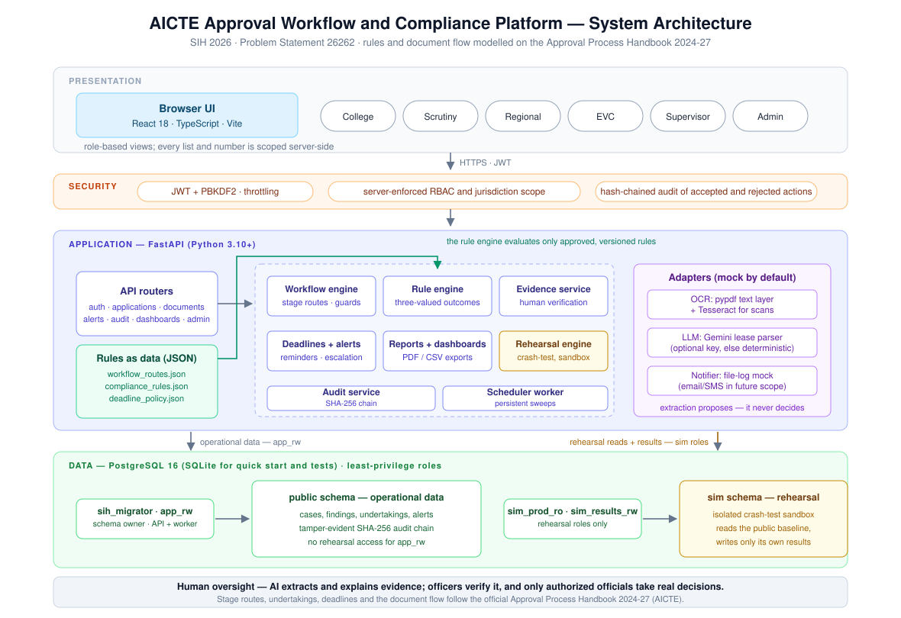

# AICTE Approval Workflow, Compliance Monitoring & Alert Management System

A working prototype built for **Smart India Hackathon 2026 — Problem Statement 26262** by AICTE (Regulation Bureau): *Integrated AICTE Approval Workflow Automation, Compliance Monitoring and Alert Management System*.

## The problem

AICTE processes approval applications from technical institutions through several stages — scrutiny, Expert Visit Committee (EVC), SAC/SHC — and many approvals come with time-bound conditions: undertakings, compliance submissions, lease renewals. Today, tracking where each application is, what is pending with whom, which documents are about to expire, and who needs a reminder all involves manual coordination and follow-up.

This prototype is a single platform that does that coordination automatically: it routes applications through the prescribed stages, keeps everyone on a shared dashboard, watches every deadline, and raises the alert — and escalates — when something is running late or a document has gone stale.

## What it does

| Problem statement asks for | What the prototype provides |
|---|---|
| A. Workflow automation | Configurable stage routes (scrutiny-only, scrutiny + EVC, EVC + SAC/SHC), automatic movement to the next stage, officer-authorized return/revert with a recorded reason |
| B. Dashboards & pendency | Role-based dashboards (institution, scrutiny, regional, EVC, supervisor, admin), server-scoped so no one sees cases outside their jurisdiction; application ageing and workload views |
| C. EVC scheduling & alerts | EVC queue fed automatically after preliminary processing, scheduling/deadline tracking and reminders |
| D. Undertakings & compliance | Digital record of approvals-with-conditions, evidence submission, officer verification, deadline reminders and escalation |
| E. Lease & document validity | Validity dates tracked per document, advance expiry alerts, renewed-document submission and verification |
| F. Alerts, escalation & audit | Scheduled alert worker with dedupe, escalation to designated officials, PDF/CSV reports, and a SHA-256 hash-chained audit trail of every action — and every rejected action |

One deliberate idea runs through the whole system: **the analyst does not decide.** Evidence extraction (pypdf text layer, Tesseract OCR, and — for lease agreements — Gemini as the external parser) produces fields for a human to verify. Compliance then evaluates the *verified* fields against version-controlled rules, and only an authorized officer can take a real workflow action. Decisions stay with people; the platform does the watching and the chasing. For a risky call, an officer can also rehearse a hypothetical decision against the same immutable rules in a read-only simulation schema before committing anything to the real case.

### Where the rules and the document flow come from

Nothing in the engine is guessed. The stage routes, the scrutiny → EVC → SAC/SHC progressions, return/revert reasons, undertakings, compliance windows, deadline policy and the shape of each required document are modelled on the **official Approval Process Handbook 2024-25 to 2026-27** issued by AICTE ([the handbook, PDF](https://cdnbbsr.s3waas.gov.in/s35938b4d054136e5d59ada6ec9c295d7a/uploads/2025/03/2025031399.pdf)). Today, the active rule sets are versioned JSON in `backend/rules/` (`workflow_routes.json`, `compliance_rules.json`, `deadline_policy.json`); updates to those files do not require application code changes. AICTE clause numbers are never invented: an unverified rule carries "clause mapping pending verification" until someone pins it to the exact handbook clause.

## Tech stack

- **Backend:** Python 3.10+, FastAPI, SQLAlchemy 2.x, Alembic; policy as data (`backend/rules/*.json`), no hardcoded routes, fees or deadlines
- **Frontend:** React 18 + TypeScript (strict) + Vite, minimal dependencies
- **Database:** PostgreSQL 16 in Docker, SQLite for quick starts and tests
- **Security:** server-side RBAC with jurisdiction scoping, PBKDF2-SHA256 sign-in, JWT with revocation on password change, four least-privilege database roles, hash-chained audit log
- Tests: **858 pytest tests** passing; CI green via GitHub Actions

## Quick start (5 minutes)

You need **Python 3.10+** and **Node 20+**. Nothing else.

```bash
git clone https://github.com/reyyishreyas/sih26262.git
cd sih26262
make setup    # creates the venv, installs packages, writes config, seeds a demo SQLite DB (~1 min)
make dev      # starts the backend (:8000) and the UI (:5173) together
```

Open **http://localhost:5173** and sign in:

| Panel | Email | Password |
|---|---|---|
| I am the College | `institution@demo.local` | `DemoPassw0rd!` |
| I am the Checker | `scrutiny@demo.local` | `DemoPassw0rd!` |

More checker roles (`regional@`, `evc@`, `supervisor@`, `admin@demo.local`) are behind **"Sign in as a different checker role"** — pick one and the form fills the email in. Every seeded credential is synthetic demo data, in the demo password above.

That's the whole loop: `make setup` once, `make dev` every time after.

## Setup guide for evaluators (step by step)

1. **Install the prerequisites.** Python 3.10 or newer, and Node.js 20 or newer. On macOS: `brew install python node`. On Ubuntu: `sudo apt install python3 nodejs npm` (check `python3 --version` ≥ 3.10).
2. **Get the code.** `git clone https://github.com/reyyishreyas/sih26262.git` and `cd sih26262`.
3. **Run setup.** `make setup` — under 5 minutes on a normal connection. It checks prerequisites, creates the virtualenv, installs Python and npm packages, writes `.env` from the example, seeds a synthetic demo database and self-checks.
4. **Start the app.** `make dev`. You'll see `[ok] API` and `[ok] UI`; the terminal streams both logs; **Ctrl-C** stops both cleanly.
5. **Walk the happy path (~10 minutes).**
   - Sign in as the College, open `app-main-0001`, upload a document, see extracted fields and their evidence region highlighted.
   - Sign in as the Checker (scrutiny), see the same case on your side: verify/reject fields, watch the rule engine produce typed outcomes (PASS / FAIL / NEEDS_REVIEW / NOT_APPLICABLE).
   - As supervisor or regional, open the dashboards — everything is scoped to your region, and the numbers reconcile with the case lists.
   - Look at the alerts and the audit trail: every action, including rejected ones, is in the chain.
6. **Optional but recommended checks** (from the repo root, with the Compose stack or after `make setup`):
   - `make test` — full backend suite.
   - `docker compose up -d --build && make smoke` — starts the full PostgreSQL stack and exercises the API end to end.
   - `make verify-isolation` — proves the least-privilege database roles live: the app role really cannot reach the simulation schema, the rehearsal reader really is read-only.

If anything misbehaves: `make seed` (idempotent) re-seeds demo data; `rm backend/sih26262.db && make setup` gives a brand-new demo state. Scanned-PDF OCR needs Tesseract: `brew install tesseract` or `apt install tesseract-ocr` (PDFs with a text layer work without it).

## Seeded demo cases

| ID | Situation |
|---|---|
| `app-main-0001` | New institution in scrutiny — lease valid to 2028-03-31 but ownership record says 2027-03-31, affidavit missing. Produces PASS, FAIL, NEEDS_REVIEW and NOT_APPLICABLE outcomes on one screen |
| `app-second-0002` | A different institution submitted a lease with the same file hash — duplicate-detection demo |
| `app-existing-0003` | Existing institution, complete evidence, approvable on the scrutiny-only route |
| `app-draft-0004` | Draft application used for upload demos |

All people, institutions, documents and outcomes are synthetic.

## Architecture



The same three-valued rule engine serves the live workflow and the read-only rehearsal sandbox, but through separate database roles: the API's role can touch operational data only, the rehearsal engine reads the baseline with a different read-only role and writes results with a third. `make verify-isolation` proves that contract against the live database.

## Running the full stack (PostgreSQL)

`make up` builds four containers, runs Alembic as the schema owner, applies least-privilege grants, seeds and serves. `make reset` stops and clears everything. For a deployment-shaped stack (required secrets, non-root images, no fixed clock, fail-fast production config), see [docs/PRODUCTION.md](docs/PRODUCTION.md) and use `docker-compose.prod.yml`.

The rehearsal isolation above is **database-enforced only on PostgreSQL** — one reason to demonstrate on `make up`, not just `make dev`.

## Repository map

```
backend/
  app/api/        FastAPI routers: auth, applications, documents, compliance,
                  workflow, undertakings, alerts, audit, dashboards, admin, reports
  app/services/   rule engine, workflow, deadlines/alerts, evidence, rehearsal,
                  reports, audit — business logic lives here, routers stay thin
  app/adapters/   OCR / LLM / notification interfaces + mock implementations
  app/workers/    persistent deadline & alert scheduler
  rules/          compliance_rules.json, workflow_routes.json, deadline_policy.json
  migrations/     Alembic revisions
  tests/          858 tests
frontend/         React + TypeScript review UI ("I am the College" / role dashboards)
scripts/          setup.sh, dev.sh, smoke.sh
docs/             architecture, rules, roles, data model, production
Makefile          setup / dev / up / reset / lint / test / smoke / verify-isolation
```

Further reading: [architecture](docs/ARCHITECTURE.md) · [compliance rules](docs/RULES.md) · [role model](docs/ROLE_MODEL.md) · [data model](docs/DATA_MODEL.md) · [user journey](docs/USER_JOURNEY.md) · [rehearsal engine](docs/REHEARSAL_ENGINE.md) · [demo script](docs/DEMO_SCRIPT.md) · [acceptance tests](docs/ACCEPTANCE_TESTS.md) · [what is deliberately not built](docs/DEFERRALS.md)

## Roadmap — future scope

To be plain about it: this is an unfinished prototype, built under hackathon deadlines. Within that scope we chose depth over breadth — the end-to-end pipeline today is exercised on a small set of prescribed documents (EoA letter, lease agreement, affidavit, ownership record) evaluated against a starter subset of the APH rules. The next stages of work:

- **Full APH coverage.** Extend the rule set from this starter subset to the complete rule catalogue of the Approval Process Handbook — every document type, every applicable condition.
- **An admin rules panel with PDF-to-configuration ingestion.** Planned workflow: an administrator uploads the complete, newly published rules/handbook PDF; the system extracts and chunks its text, indexes those chunks for retrieval (RAG), and uses the retrieved passages to draft the corresponding rules in the existing versioned JSON format. Each draft must retain its source page/chunk and clause reference, and remain inactive until an authorized human verifies it and a second administrator approves it under the existing four-eyes process. Once approved, the JSON rule version becomes the active configuration without editing application code or reconfiguring/redeploying the application. This assisted ingestion and automatic activation path is future work; the current prototype does not ingest a PDF or generate/activate JSON rules automatically, and AI must not make regulatory decisions or approve its own drafts.
- **A better crash-test for the college.** The rehearsal engine currently serves the checking side; we want to build the college-facing version into a richer pre-flight experience — so an institution can test its own submissions against the current rules before AICTE ever sees them.
- **Real delivery channels and integration.** Notifications currently end in a file (mock adapter); wire real email/SMS, and integrate with existing AICTE systems as the problem statement allows.
- **Production maturity.** Security audit, load testing, records-retention policy, and accessibility review before anything beyond a demonstration.

## What this is not

A prototype, not a certified government system. It has not been security-audited or load-tested, and no rule has been validated against the Approval Process Handbook by a competent authority. Automated alerts, extraction and recommendations support the process; statutory scrutiny, verification and decisions remain with the authorized officials — that boundary is enforced in the code, not just in prose. The full list of what we deferred and why is in [docs/DEFERRALS.md](docs/DEFERRALS.md).

## Team

**Parikshit** — Team Leader · Reyyi Shreyas · Srisha Prajwal · Kushal Sharma · Pranav · Deepal Jain 
